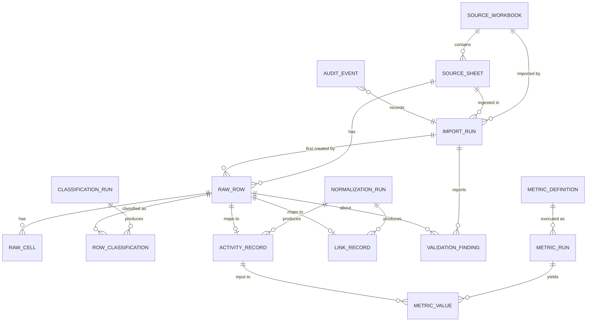

# Domain Model v1

Status: **Proposed.** Not implemented. Labels: **Confirmed** (owner decision), **Proposed**, **Unresolved**.

## 1. Principles (Confirmed)

- Source data is immutable. Raw values are preserved and traceable to workbook (hash), sheet, row, and column.
- Source values, workbook-derived values, and WorkLens-derived values are stored separately and labeled.
- Validation never deletes. No calculation exists without an approved definition.
- Business meaning is not assumed. Names follow source headers until the owner defines meaning (Q-B1 to Q-B12).

## 2. Layers (Proposed)

| Layer | Content | Mutability |
|---|---|---|
| Source file | The workbook on disk | Immutable, outside the database |
| `raw` | Workbook identity, import runs, rows, cells (value, type, formula) | Append-only |
| `domain` | Row classification, normalized activity records, link records, validation findings | Versioned; rebuilt per run, never overwritten |
| `derived` | Metric definitions and metric values | Empty until the owner approves definitions |
| `audit` | Events (imports, classifications, approvals, AI outputs) | Append-only |

## 3. Entities (Proposed)

| Entity | Layer | Purpose |
|---|---|---|
| SourceWorkbook | raw | File identity: SHA-256, size, mtime, approval reference |
| SourceSheet | raw | Sheet name, state, declared range, ingestion window |
| ImportRun | raw | One execution: tool and library versions, config hash, counts, outcome |
| RawRow | raw | One Excel row of the ingestion window, with Excel row number |
| RawCell | raw | Cell value, cell type, formula text, formula kind, error code |
| ClassificationRun | domain | One versioned application of row-class rules |
| RowClassification | domain | Row class and review state for a RawRow |
| NormalizationRun | domain | One versioned application of the source-to-domain mapping |
| ActivityRecord | domain | Typed fields mapped from an activity-structured RawRow. **Entity name and grain are provisional (Q-B1)** |
| LinkRecord | domain | Typed content of a link-only row |
| ValidationFinding | domain | Observation on a row or cell; never removes data |
| MetricDefinition | derived | Approved definition: formula, units, versioning. **None approved** |
| MetricRun / MetricValue | derived | Execution and results with provenance. **None exist** |
| AuditEvent | audit | Who or what did what, when |
| AiOutput | audit | Reviewable AI recommendation with inputs and model. **Deferred** |

## 4. Entity relationship diagram (Proposed)

## 5. Key rules (Proposed)

- Natural key of a raw row: (SourceSheet, Excel row number). Natural key of a cell: (RawRow, column index). Re-import of the same workbook hash and mapping config creates no new raw rows.
- An ActivityRecord is 1:1 with an activity-structured RawRow (provisional until Q-B1).
- A LinkRecord is 1:1 with a link-only RawRow.
- Every ActivityRecord field maps to one source column. Each field carries its origin (entered, workbook-derived cached) via the RawCell.
- A MetricValue cannot exist unless its MetricDefinition is `approved` and records a decision reference.
- Review state `unreviewed` is a property of RowClassification, not a validity flag.

## 6. Unresolved

- Q-B1 grain; Q-B3 which fields form an Assessment concept (so no Assessment entity is defined yet); Q-B10 opportunity and impact entities; Q-B12 eligibility.
- Relationships to the lookup sheets (`List App,BA,Topology`, `All SOP`) are not modeled. They are not approved sources.
