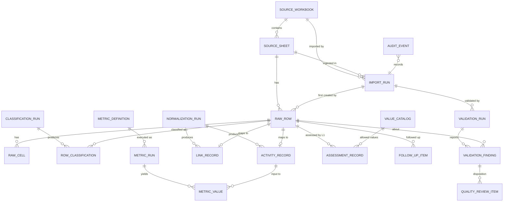

# Domain Model v1 (Phase 2 baseline)

Status: **Proposed design baseline**; not implemented. Labels: **Confirmed** (owner decision record), **Reference** (owner's Q1–Q51 answers; not yet approved technical decisions), **Proposed**, **Unresolved**. Field meanings: `DATA_DICTIONARY.md`. Column mapping: `design/SOURCE_TO_DOMAIN_MAPPING.md`. Business reference: `REQUIREMENTS_RECONCILIATION_Q1_Q51.md`.

## 1. Principles (Confirmed)

- Source data is immutable. Raw values are preserved and traceable to workbook (hash), sheet, row and column.
- Source values, workbook-derived values and WorkLens-derived values are stored separately and labeled.
- Validation never deletes. No calculation exists without an approved definition.
- Business meaning is not assumed. Where the owner has not defined a meaning, the model stores the value and names the open question.
- L1 edits and corrections never change the source (Reference Q18, G.8; consistent with the Confirmed immutability rule).

## 2. The Activity concept

- **Reference (Q3):** one row = one activity assessed. The row grain is therefore the activity grain. Confirmation as a decision record is Q-R1.
- Link-only rows (6) are not activities (Confirmed, Q-S3).
- Rows 3239–3490 (252) are activities flagged `unreviewed` (Confirmed, Q-S4). Q2 and Q7 say all activities are in assessment scope; eligibility for approved assessments remains Unresolved (Q-B12).
- An activity is identified inside one workbook version by (sheet, Excel row). Identity **across** workbook versions is Unresolved (Q-R24); it matters only once L1 data must survive a re-import.

## 3. Layers

| Layer (PostgreSQL schema) | Content | Mutability | Status |
|---|---|---|---|
| Source file | The pinned workbook | Immutable, outside the database | Confirmed |
| `raw` | Workbook identity, import runs, rows, cells (value, type, formula) | Append-only | Proposed |
| `domain` | Row classification, validation findings, normalized activity and link records | Versioned per run; never overwritten | Proposed |
| `assessment` | L1-authored assessment, quality-review dispositions, follow-up items | Versioned, append-only history; attributed | Proposed; field details gated (section 6) |
| `derived` | Metric definitions, runs, values | Empty until the owner approves definitions | Proposed |
| `audit` | Events: imports, classifications, approvals, L1 edits, AI outputs | Append-only | Proposed |

## 4. Value kinds (Proposed labels over Confirmed separation rule)

| Kind | Lives in | Notes |
|---|---|---|
| `entered` | `raw`, mirrored in `domain` | A constant in a source cell |
| `workbook_derived_cached` | `raw`, mirrored in `domain` | Formula cache plus formula text. Not an approved calculation (Q-S2). `Workload`, `Durasi after`, `Workload after` are this kind |
| `l1_authored` | `assessment` | Written by an L1 user in WorkLens |
| `worklens_derived` | `derived` | Only from an approved MetricDefinition. **None exist** |
| `ai_generated` | `audit` (AiOutput) | Reviewable. Deferred |

Every view, export and report labels each value with its kind. The 10% `Workload after` figure is a workbook-derived assumption and is never stored or shown as measured impact (Reference Q39).

## 5. Entities

"Built in" is the earliest roadmap phase that needs the entity (`ROADMAP.md`).

| Entity | Layer | Purpose | Status | Built in |
|---|---|---|---|---|
| SourceWorkbook | raw | File identity: SHA-256, size, mtime, approval reference | Proposed | Phase 3 |
| SourceSheet | raw | Sheet name, state, declared range, ingestion window | Proposed | Phase 3 |
| ImportRun | raw | One execution: versions, config hash, counts, manifest, outcome | Proposed | Phase 3 |
| RawRow | raw | One Excel row of the ingestion window with its row number | Proposed | Phase 3 |
| RawCell | raw | Cell value, type, formula text and kind, error code, origin | Proposed | Phase 3 |
| ClassificationRun / RowClassification | domain | Row class (`activity_structured`, `link_only`) and review state (`unreviewed`) per RawRow | Proposed; rules from Q-S3/Q-S4 | Phase 3 |
| ValidationRun / ValidationFinding | domain | Observation on a row or cell; never removes data | Proposed | Phase 3 |
| AuditEvent | audit | Who or what did what, when. Carries `actor_type` (`user`, `system`, `agent`) and an optional task reference | Proposed | Phase 3 |
| NormalizationRun | domain | One versioned application of the mapping | Proposed | Phase 4 |
| ActivityRecord | domain | Typed mirror of an activity-structured RawRow | Proposed. Grain per Q3 Reference | Phase 4 |
| LinkRecord | domain | Typed content of a link-only row | Proposed | Phase 4 |
| AssessmentRecord | assessment | L1's assessment of one activity | Proposed; gated | Unscheduled (Q-R16) |
| QualityReviewItem | assessment | L1 disposition of a finding or inconsistency | Proposed; gated | Unscheduled |
| FollowUpItem | assessment | Follow-up and coordination for an activity | Proposed; gated | Unscheduled |
| ValueCatalog | assessment | Versioned allowed values for L1 fields (categories, notes, statuses) | Proposed; contents Unresolved | Unscheduled |
| MetricDefinition | derived | Approved definition: formula, units, versioning. **None approved** | Proposed; gated | Phase 5–6 |
| MetricRun / MetricValue | derived | Execution and results with provenance. **None exist** | Proposed; gated | Phase 6 |
| AiOutput | audit | Reviewable AI output with inputs by reference | Proposed; Deferred | Track H3 |

**Not entities (Proposed):** the Enriched CSV and the Assessment Report are projections generated from the entities above, not stored source data (section 7). `Assessment` as a free-standing concept is not defined; Q11 lists its outputs and `AssessmentRecord` holds them.

## 6. L1 assessment layer (Proposed; design detail gated)

Why it exists: the Reference requires L1 to edit assessment, `Improvement Category`, `Category Notes`, Quality Review and Follow-up (Q51), while the source is immutable (Q18, G.8). Edits therefore go to a separate, attributed layer.

**AssessmentRecord** (one current version per activity, full history kept)

| Field | Origin in the Reference | Status |
|---|---|---|
| activity reference (RawRow) | Q3 | Proposed |
| `improvement_category` | Q12, Q20 | Proposed; allowed values from ValueCatalog (Q-R5) |
| `category_notes` | Q13, Q14 | Proposed; catalog (Q-R4, Q-R7) |
| `tools_automation` | Q26, Q27 | Proposed |
| `reasoning` | Q11 | Proposed; no workbook column (Q-R8) |
| `information_gaps` | Q7 | Proposed |
| `l2_feedback` / `l2_support_needed` | Q5, Q11 | Proposed; whether to use empty AE/AF columns or new fields is open (Q-R8). L2 is not a user (Q4, Q44), so L1 records L2 input |
| `assessment_status` | Q8, Q9 | Proposed; states and transitions Unresolved (Q-R9). Only L1 can set `Done` (Q9) |
| version, `created_by`, `created_at`, `change_reason` | Q51 attribution, G.8 | Proposed |

**QualityReviewItem:** links a ValidationFinding (or a named inconsistency such as a category/notes mismatch under Q14) to an L1 disposition: state (catalog, Unresolved), note, reviewer, timestamp, version. It never edits the finding or the source (Q18).

**FollowUpItem:** activity reference, `action_by`, description, status (catalog, Unresolved), coordination note, author, timestamps, version. Detailed relation between tools and follow-up was deferred in the Reference (G.3). `Part of L2` and L0 handling stay open (Q-R18); L0/L2 are not over-engineered (Q44).

**Effective view (Proposed):** for display and export, each assessment field resolves to the current L1 value if one exists, otherwise to the workbook mirror value. Each shown value keeps its kind label and source. Alternatives (seeding the layer from workbook values; no precedence) are Unresolved (Q-R25). No data is copied unless the owner chooses seeding.

**Management** has read access only, with summary and drill-down (Q49, Q51). No Management entity or comment record exists; Management comments are Unresolved (Q-R11).

**Not stored:** monitoring of running automation (Q36 is outside assessment).

## 7. Enrichment, export and report (Proposed)

- **Enriched CSV (Q45, Q50):** a generated projection. Each column is labeled with its value kind. Which columns are included ("enrichment") is Unresolved (Q-R14). Workload columns are included only as `workbook_derived_cached` unless an approved metric exists. The export is sensitive data and is audited.
- **Assessment Report (Q45, Q50):** a generated document with a manifest of its inputs and value kinds. Contents and authorship of recommendations are Unresolved (Q-R15). Whether generated files are stored or regenerated is Proposed: regenerate from run ids; store only the manifest.
- Neither is a source of truth.

## 8. Entity relationship diagram (Proposed)

## 9. Key rules (Proposed unless noted)

- Natural key of a raw row: (SourceSheet, Excel row). Of a cell: (RawRow, column index). Re-import of the same workbook hash and mapping config creates no new raw rows (idempotency).
- An ActivityRecord is 1:1 with an activity-structured RawRow; a LinkRecord with a link-only RawRow.
- Every ActivityRecord field maps to one source column; its origin comes from the RawCell.
- Assessment-layer rows reference a RawRow of a specific import. They survive neither re-import nor a new workbook version until activity identity is decided (Q-R24). Phase 3 and 4 are unaffected.
- Every L1 edit appends a new version and an AuditEvent holding ids and field names, not values.
- A MetricValue cannot exist unless its MetricDefinition is `approved` with a decision reference (Confirmed gate).
- `unreviewed` is a property of RowClassification, not a validity flag (Confirmed, Q-S4).
- AI never writes to `raw`, `domain`, `assessment` decisions, or `derived` (Confirmed principle).

## 10. MVP capabilities and entities (Q50, Reference)

| Capability | Entities used |
|---|---|
| Assessment Workspace (L1) | ActivityRecord (effective view), AssessmentRecord, ValueCatalog, ValidationFinding |
| Monitoring Dashboard (Management) | Counts over ActivityRecord, RowClassification, AssessmentRecord, QualityReviewItem, FollowUpItem (definitions of business-field counts: Q-R17) |
| Download Enriched CSV | Projection over ActivityRecord, AssessmentRecord, derived values with kind labels |
| Generate Assessment Report | Projection plus manifest |
| Quality Review | ValidationFinding, QualityReviewItem |
| Follow-up Management | FollowUpItem |

## 11. Unresolved gates for this model

| Gate | Blocks | Not blocked |
|---|---|---|
| Q-R1 confirm Q3 grain | Phase 4 normalization sign-off | Phase 3 |
| Q-R8, Q-R9, Q-R5, Q-R4, Q-R7 (fields, states, catalogs) | Detailed design and build of the L1 layer | Phases 3 and 4 |
| Q-R13, Q-R24, Q-R25 (system of record, identity across versions, effective-value semantics) | L1 layer build; any re-import after L1 edits exist | Phase 3, 4 |
| Q-R3, Q-R2 (workload gate, saving formula) | `derived` layer | Everything else |
| Q-R11 Management comments | Comment feature only | |
| Q-R14, Q-R15 export and report contents | Export and report build | |
| Relationships to lookup sheets (`List App,BA,Topology`, `All SOP`) | Not modeled; not approved sources | |
